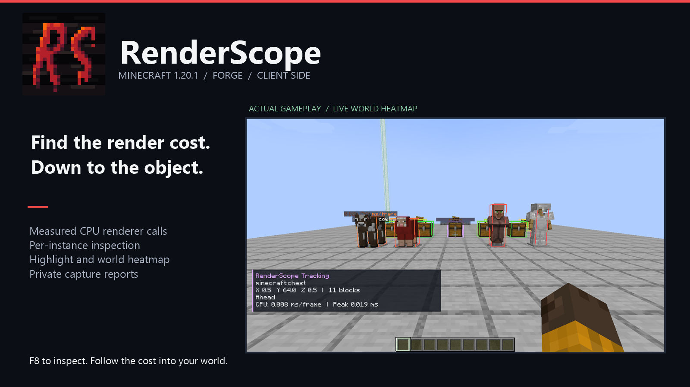
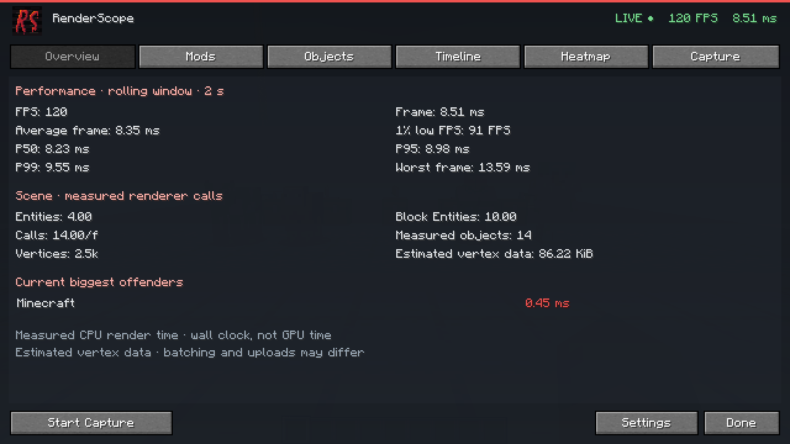
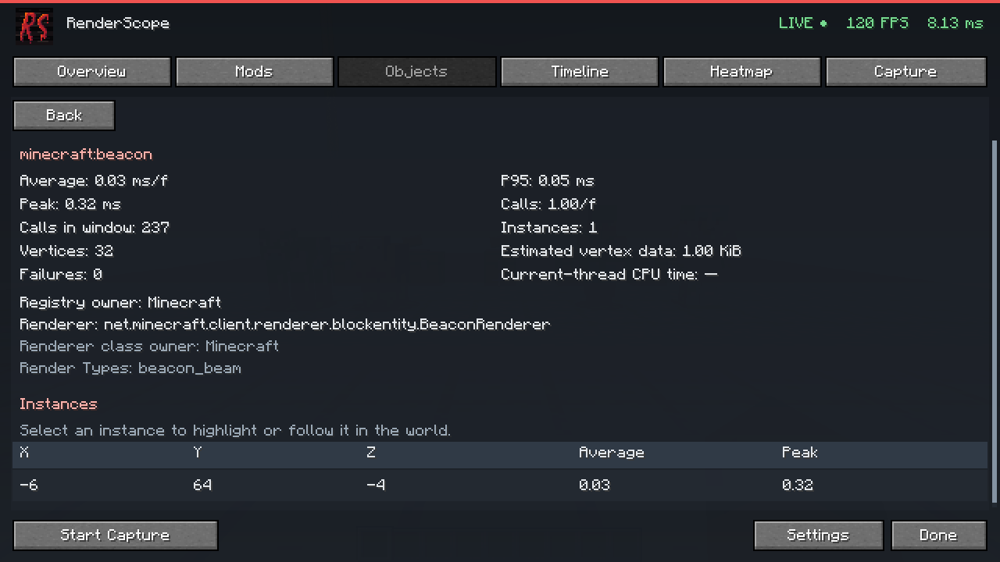
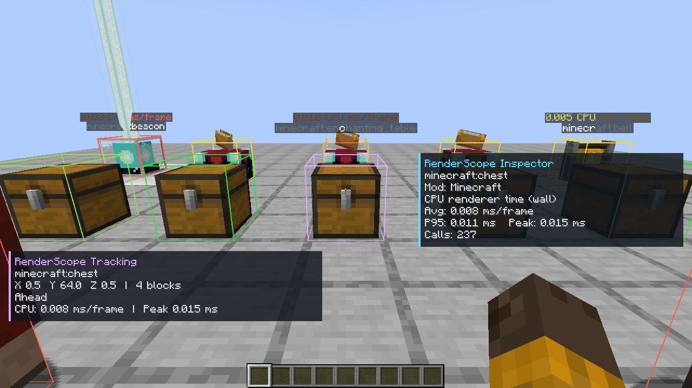
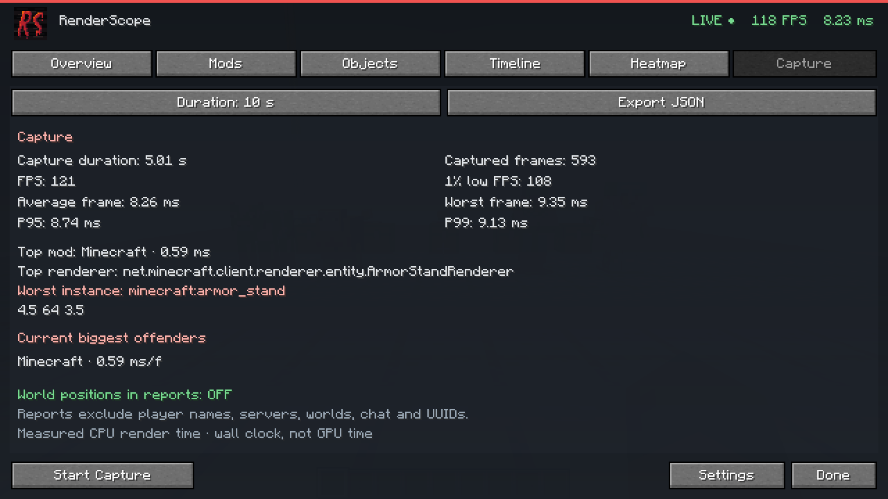

# RenderScope



**Найдите конкретную сущность или блок-сущность, на рендер которой уходит время.**

RenderScope — клиентский профилировщик для **Minecraft Java 1.20.1** с отдельными сборками для **Forge 47.4.10** и **NeoForge 47.1.106**. Он связывает измеренные вызовы рендереров с модом, типом объекта и отдельным экземпляром в мире. Из списка можно перейти к координатам, включить подсветку и отслеживать выбранный объект.

Мод собирает настоящие измерения во время игры. Устанавливать его на сервер не нужно: интерфейс, сбор данных и подсветка работают на клиенте, без собственных сетевых пакетов.

## Установка и первый запуск

1. Установите **Forge 47.4.10** либо **NeoForge 47.1.106** для Minecraft 1.20.1 и запускайте профиль на **Java 21**.
2. Поместите соответствующий основный JAR из таблицы ниже в папку `mods` игрового профиля. MixinExtras включён внутрь него.
3. Загрузите мир или подключитесь к серверу и дайте профилировщику несколько секунд собрать данные.
4. Нажмите **F8** либо откройте **Esc → RenderScope**. Клавишу можно изменить в **Настройки → Управление → RenderScope**.

| Загрузчик профиля | Файл |
| --- | --- |
| Forge 47.4.10 | [renderscope-forge-0.1.0+mc1.20.1.jar](distribution/forge/renderscope-forge-0.1.0+mc1.20.1.jar) |
| NeoForge 47.1.106 | [renderscope-neoforge-0.1.0+mc1.20.1.jar](distribution/renderscope-neoforge-0.1.0+mc1.20.1.jar) |

В один игровой профиль устанавливайте **только один** RenderScope JAR для его загрузчика. Файлы `-slim` и `-sources` не являются самостоятельным дистрибутивом. Исходная NeoForge-сборка сохранена отдельно от Forge-порта.

Интерфейс RenderScope не приостанавливает игровой мир. В одиночной игре возвращение в обычное меню паузы снова включает его стандартное поведение.

## Как найти тяжёлый объект

1. В **Overview / Обзор** посмотрите время кадров и список модов с самым дорогим измеренным рендером.
2. В **Mods / Моды** выберите строку мода. Заголовки таблицы меняют сортировку и её направление; поле поиска фильтрует результаты.
3. В **Objects / Объекты** выберите категорию **Entities** или **Block Entities**, затем нужный registry ID.
4. В подробностях выберите экземпляр по координатам. **Highlight** включает временную подсветку, **Track** сохраняет отслеживание, **Copy Position** копирует позицию.
5. Закройте экран и найдите выделенный объект непосредственно в мире. Повторное нажатие отключает выделение или отслеживание.

**Heatmap / Теплокарта** показывает сравнительную стоимость видимых измеренных объектов: зелёный соответствует более дешёвым экземплярам, красный — самым дорогим. Доступны фильтры категорий, расстояние, лимит объектов, минимальная стоимость, подписи и показ сквозь стены. **Inspect** включает информацию о профилированном объекте под прицелом.

## Что есть в MVP

| Экран | Реальные данные и действия |
| --- | --- |
| Overview | FPS, текущий и средний кадр, 1% low, P50/P95/P99, худший кадр, вызовы и измеренные объекты |
| Mods | Время и доля измеренного рендера, вызовы, экземпляры двух категорий, наблюдаемые вершины, подробности мода |
| Objects | Среднее/P95/пик, вызовы, экземпляры, класс рендерера, владельцы registry ID и реализации, RenderType |
| Timeline | Последние 30 секунд; выбор FPS или одного из четырёх временных графиков; нажатие на кадр открывает его фактические источники нагрузки |
| Heatmap | Подсветка в мире, относительные цвета, инспектор под прицелом |
| Capture | Записи на 5, 10, 30 секунд или вручную; итоговая статистика и экспорт JSON |
| Settings | Сбор данных, Timing Only / Full, окно 1–30 секунд, опциональный thread CPU timer, настройки подсветки и отчётов |

Стандартное окно статистики — **5 секунд**. Профилировщик продолжает работать при закрытом интерфейсе. В маленьком окне таблицы и подробности прокручиваются; сокращённые значения раскрываются при наведении. Доступны английская и русская локализации.

## В игре

Галерея Forge-сборки: локальная сцена с vanilla-объектами. Значения относятся к этой сцене и оборудованию; это не обещание определённой производительности других модов.

Оба варианта прошли отдельные сборки на JDK 21, по 17 unit/privacy-тестов и запуск настоящего клиента в среде разработки с проверкой загрузчика, renderer calls, capture и экспорта. Результаты: [Forge 47.4.10](distribution/forge/verification.json) и [NeoForge 47.1.106](distribution/verification.json).









Отдельно сохранены [скриншот NeoForge](distribution/gallery/01-overview.png), [его анимация](distribution/gallery/heatmap-demo.gif) и [результаты проверки](distribution/verification.json).

## Как читать измерения

Основная величина — **прошедшее время CPU-side вызова `renderer.render(...)`**, измеренное через `System.nanoTime()`. Оно включает подготовку и отправку команд, а также возможные ожидания драйвера. Это **не время исполнения на GPU** и не полная стоимость всех подсистем рендера Minecraft.

MVP измеряет мировые **EntityRenderer** и **BlockEntityRenderer**. Terrain, частицы, GUI, предметы вне этих вызовов и отдельные шейдерные проходы не входят в его атрибуцию по модам. Медленный кадр может быть вызван и другими подсистемами. Проценты в Mods относятся к сумме измеренных вызовов.

**Timing Only** — стандартный режим. **Full** дополнительно наблюдает вершины, проходящие через `BufferBuilder`, и запросы `RenderType` через стандартный `BufferSource`. Альтернативные пути рендера могут обходить эти счётчики. `Estimated vertex data` — оценка объёма наблюдаемой геометрии; она не является GPU upload bytes, VRAM или GPU memory. Подробнее: [методика измерений](docs/MEASUREMENTS.md).

## Запись и приватность

Нажмите **Start Capture**, воспроизведите проблемную сцену, завершите запись и выберите **Export JSON**. Файлы сохраняются в `<minecraft>/renderscope-reports/renderscope-YYYY-MM-DD_HH-mm-ss-SSS.json`.

В отчёт входят версии Minecraft, фактического загрузчика Forge или NeoForge и RenderScope, названия и версии установленных модов, сводка производительности и метрики модов, рендереров, объектов и кадров. Экспорт выполняется локально; мод не отправляет отчёты автоматически.

Имена игроков, адреса и названия серверов, имена миров, чат, UUID и абсолютные пути не включаются. Координаты и измерение также исключены по умолчанию; включить их можно только через **Settings → Reports → Include world positions**.

Настройки сохраняются в `config/renderscope.json` игрового профиля. Данные сессии и выделения сбрасываются при смене мира или измерения.

## Сборка из исходников

Нужен установленный **JDK 21**. Обёртка Gradle **8.8** включена в проект. По умолчанию собирается **Forge**. В PowerShell из корня репозитория скрипт выбирает JDK 21, собирает выбранный загрузчик и копирует основной готовый JAR в его каталог:

```powershell
.\scripts\build.ps1 -Loader forge
.\scripts\build.ps1 -Loader neoforge
```

Скрипт ищет Java 21 через `JAVA_HOME`, в стандартной папке `C:\Program Files\Java\jdk-21` и в локальной `.tools/`. Если JDK установлен в другом месте, задайте `JAVA_HOME`. При ручной сборке также выберите именно Java 21: версия `java` в системном PATH может отличаться.

```powershell
# Замените путь на каталог установленного JDK 21.
$env:JAVA_HOME = 'C:\Program Files\Java\jdk-21'
& "$env:JAVA_HOME\bin\java.exe" -version
.\gradlew.bat -Ploader=forge test build
.\gradlew.bat -Ploader=neoforge test build
```

Результаты двух сборок не перезаписывают друг друга:

| Выбор | Результат Gradle | Готовый дистрибутив |
| --- | --- | --- |
| `forge` (по умолчанию) | `build/forge/libs/` | `distribution/forge/` |
| `neoforge` | `build/neoforge/libs/` | `distribution/` |

Для обычной среды разработки, с тем же `JAVA_HOME`:

```powershell
.\gradlew.bat -Ploader=forge runClient
# Для исходной NeoForge-сборки:
.\gradlew.bat -Ploader=neoforge runClient
```

Для воспроизводимой проверки в настоящем Minecraft включён отдельный source-only smoke harness:

```powershell
.\scripts\build.ps1 -Loader forge -Smoke
.\scripts\build.ps1 -Loader neoforge -Smoke
```

Скрипт запускает Gradle-задачу `runSmokeClient` выбранного загрузчика. Профили изолированы в `run-smoke-forge/` и `run-smoke-neoforge/`. Harness создаёт реальную сцену с vanilla-объектами, проверяет измерения и экспорт и снимает игровые скриншоты. Forge-результаты сохраняются в `distribution/forge/`, NeoForge-результаты — в `distribution/`: `smoke-result.json`, `smoke-capture-example.json` и `gallery/`. При успешном завершении в логе появляется `RENDERSCOPE_SMOKE_SUCCESS`, затем тестовый клиент закрывается. Harness находится в source set `smoke` и не входит в основной JAR.

Проверка и упаковка материалов также выбирают загрузчик; Python-скрипт упаковки использует Pillow:

```powershell
python .\scripts\verify-release.py --loader forge
python .\scripts\package-release.py --loader forge
# Для NeoForge используйте --loader neoforge.
```

Обе сборки используют JDK 21 с `--release 17`: загрузчики ветки 1.20.1 должны читать совместимый байткод. Требование запуска клиента на Java 21 сохраняется. Forge разрешается через `net.minecraftforge:forge`, NeoForge — через исторические координаты `net.neoforged:forge`; пакеты `net.minecraftforge` общие для этих веток 1.20.1.

Архитектура и точки инструментирования описаны в [ARCHITECTURE.md](docs/ARCHITECTURE.md). Текущие Forge/NeoForge-релизы предназначены для **1.20.1**; сборки для 1.21.1 и Fabric не заявлены.

## Материалы для публикации

Для **Forge** подготовлены [Modrinth](distribution/forge/MODRINTH.md), [CurseForge](distribution/forge/CURSEFORGE.md), [русское описание](distribution/forge/DESCRIPTION_RU.md), [метаданные alpha-релиза](distribution/forge/release.json) и [контрольный список](distribution/forge/RELEASE_CHECKLIST.md).

Материалы исходной **NeoForge**-сборки сохранены: [Modrinth](distribution/MODRINTH.md), [CurseForge](distribution/CURSEFORGE.md), [русское описание](distribution/DESCRIPTION_RU.md), [метаданные](distribution/release.json) и [контрольный список](distribution/RELEASE_CHECKLIST.md). Это локальные материалы для последующей загрузки на площадки; галереи каждого загрузчика получаются его собственным запуском Minecraft.

В `distribution/brand/` находятся исходное лого 24×24 и PNG, увеличенные целочисленным nearest-neighbor масштабированием. Пиксельная сетка сохраняется без размытия. Квадратные иконки 512×512 и 1024×1024 используют поля в цвет фона исходника и целочисленный масштаб рисунка.

Код: **All Rights Reserved** до выбора владельцем проекта другой лицензии. Логотип предоставлен владельцем проекта.
