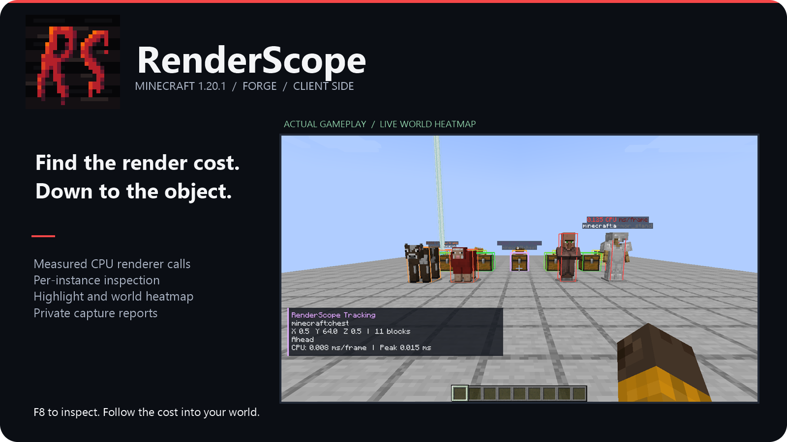
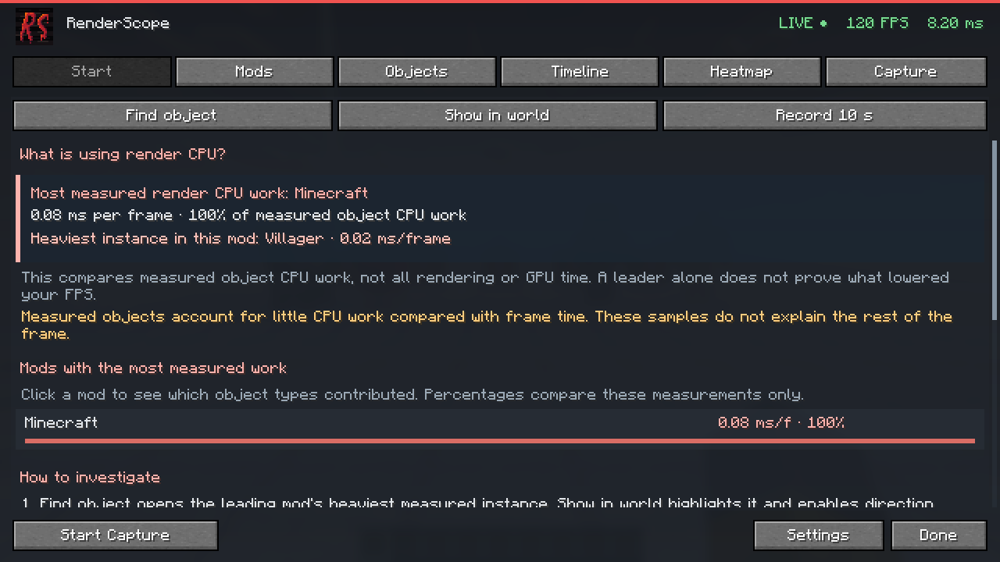
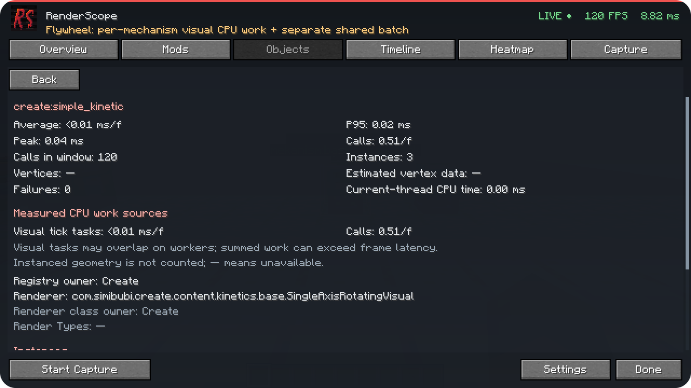
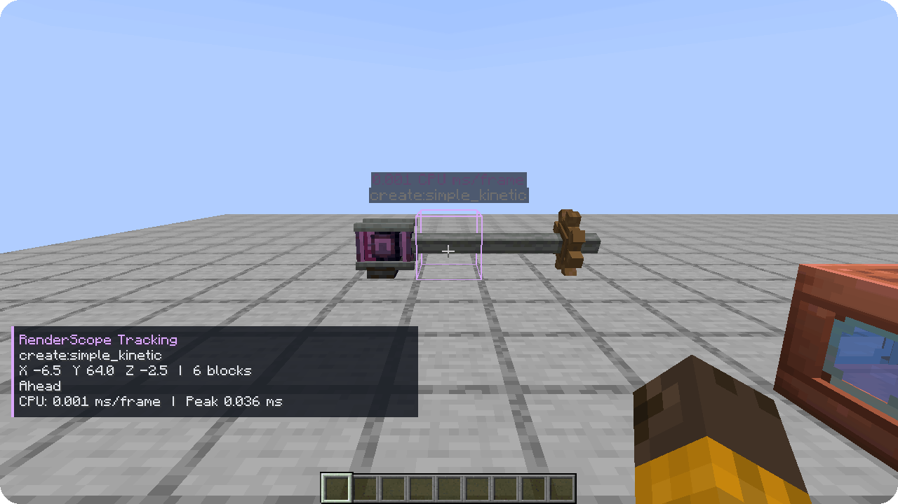
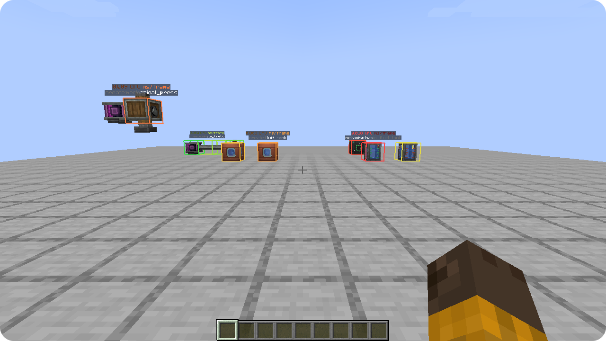
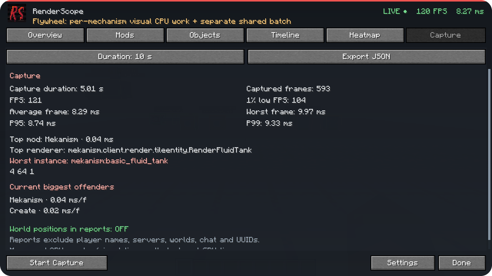

# RenderScope

**Find the render cost. Follow it into your world.**



**RenderScope 0.3.0 · Minecraft 1.20.1–26.3 · Fabric / Forge / NeoForge · Client-side**

Choose the JAR for your **exact Minecraft version and loader** in the [0.3.0 downloads](distribution/0.3.0/README.md). The [build and game-test matrix](docs/compatibility/SUPPORT-MATRIX.md) records actual build results and the exact hashes tested in Minecraft. Forge has no upstream release for Minecraft 1.20.5 or 1.21.2. Minecraft 26.x requires Java 25; earlier targets use Java 21.

The first page explains which mod has the most measured object-render CPU work and shows its heaviest measured instance. Preliminary measurements are labelled while more samples accumulate. The screen also explains when these objects account for too little work to explain the rest of a slow frame.

Minecraft **1.20.1–1.21.8** adapters use **Start**, with **Find object**, **Show in world** and **Record 10 s**. The newer **1.21.9–26.3** UI uses **Overview**, **Show the instance**, **Inspect measured mods** and **Start Capture**; capture duration is selected in its Capture tab. Both UI families keep detailed tables and world inspection.



Native Sodium / Embeddium / Rubidium counters, Iris / Oculus shadow handling and Mekanism Extras attribution have explicit version gates. Read the [exact optional-renderer coverage](docs/OPTIONAL-RENDERER-COMPATIBILITY.md) before combining them with Create. Unknown native rendering APIs retain available dispatcher timing and show partial coverage.

[Features](#follow-the-cost) · [Install](#install) · [Русский](#русский) · [Development](#development)

RenderScope connects measured rendering work to a mod, an object type, and a specific instance in your world. Find a costly renderer, select its entity or block entity, and highlight the object you want to investigate.

---

## Follow the cost

1. Open **F8** or **Esc → RenderScope**.
2. Choose a mod in **Mods**, then inspect a type in **Objects**.
3. Select an instance and use **Highlight**, **Track**, or **Copy Position**.

Per-frame average, P95, peak, calls, renderer implementation and CPU work sources help explain what the profiler observed. Registry ownership and renderer ownership are shown separately.



## See the object in your world

**Highlight** marks your selection in the world. **Track** adds a direction and distance HUD. The **heatmap** compares nearby measured instances using relative green/yellow/red costs; **Inspect** shows the measured object under your crosshair.



Filters cover distance, object categories, minimum cost, object limits, labels and through-wall display. Profiling continues while the screen is closed.



## Catch a spike and keep the evidence

**Start / Overview** shows FPS, frame-time percentiles, 1% low and measured offenders. **Timeline** keeps about 30 seconds of frame history; click a frame to inspect its attribution. Record **5 / 10 / 30 seconds** or stop manually, then export a local JSON report.



## Install

Place one main JAR from [0.3.0 downloads](distribution/0.3.0/README.md) matching your **exact Minecraft version and loader** in your client profile's `mods` folder. Fabric also requires the matching Fabric API. See the [0.3.0 matrix](docs/compatibility/SUPPORT-MATRIX.md) for individual build and world-test results.

The previous **0.2.0 / Minecraft 1.20.1** builds also remain available:

| Loader | RenderScope 0.2.0 |
| --- | --- |
| Forge 47.4.10 | [Download Forge JAR](distribution/forge/renderscope-forge-0.2.0+mc1.20.1.jar) |
| NeoForge 47.1.106 | [Download NeoForge JAR](distribution/renderscope-neoforge-0.2.0+mc1.20.1.jar) |

Open a world, wait a few seconds, and press **F8**. Rebind it under **Options → Controls → RenderScope**. Runtime integration dependencies come from the matching JAR or its loader. **The server does not need RenderScope.** English and Russian UI are included.

## What the numbers mean

| Metric | What RenderScope observes |
| --- | --- |
| Instance CPU work | Renderer calls, supported Flywheel visual tasks and attributed Mekanism deferred callbacks |
| Shared Flywheel CPU | Batch submission measured separately from object/mod totals |
| Shared Flywheel GPU | Real asynchronous OpenGL timestamps in Full mode, when supported |
| Estimated vertex data | Standard BufferBuilder geometry; alternative pipelines can bypass these counters |

**Timing Only** is the default. **Full** adds geometry where the adapter can observe it. The supported Minecraft 1.20.1 / Flywheel 1.0.5 integration also provides a live shared GPU view. Parallel visual CPU intervals can overlap; their sum can exceed frame latency. GPU time and instanced geometry are not divided among objects, and the live GPU diagnostic is not exported as a capture.

The installed Forge test used **Create 6.0.8 / Flywheel 1.0.5 / Ponder 1.0.91 and Mekanism 10.4.16.80**. These optional mods are not required. Virtual contraption block entities are not individually attributed at world positions; terrain, particles, GUI and standalone shader passes are outside this profiling scope. See [measurement details](docs/MEASUREMENTS.md).

## Private reports by default

Reports stay in your profile's `renderscope-reports` folder. They include versions, installed mod names/versions and measured CPU sources/phases. **Positions and dimensions are off by default.** Player names, server addresses, world names, chat, UUIDs and absolute paths are excluded. RenderScope does not upload reports.

---

## Русский

**Найдите конкретный объект, на рендер которого уходит время.** RenderScope связывает измерения с модом, типом объекта и отдельным экземпляром мира.

1. Выберите JAR **строго под свою версию Minecraft и загрузчик** в [загрузках 0.3.0](distribution/0.3.0/README.md). Результаты игровых проверок указаны в [матрице](docs/compatibility/SUPPORT-MATRIX.md). Для Fabric нужен Fabric API. Для Minecraft 26.x нужна Java 25, для предыдущих целей — Java 21. На сервер мод не нужен.
2. Откройте **F8** или **Esc → RenderScope**. После накопления измерений первая страница показывает мод с самой дорогой наблюдаемой CPU-работой отрисовки и конкретный экземпляр.
3. В адаптерах **1.20.1–1.21.8** это вкладка **Главная**: **Найти объект** открывает подробности, **Показать в мире** включает подсветку и направление, **Записать 10 с** начинает захват. В интерфейсе **1.21.9–26.3** используются **Обзор**, **Показать объект**, **Изучить моды** и **Начать запись**; длительность выбирается на вкладке записи. Подробные таблицы, теплокарта и инспектор доступны в обоих семействах.

Процент сравнивает измеренную CPU-работу объектов. Он не выдаётся за долю всей видеокарты и не обещает прирост FPS после удаления мода. Если измерений мало или основные затраты находятся вне профилируемых объектов, интерфейс прямо об этом сообщает. Для Sodium/Iris/Embeddium/Rubidium и Mekanism Extras указаны [точные версии и результаты совместимости](docs/OPTIONAL-RENDERER-COMPATIBILITY.md).

**Теплокарта** сравнивает стоимость объектов цветом, **Inspect** показывает объект под прицелом. **Timeline** хранит около 30 секунд истории, **Capture** записывает 5/10/30 секунд или до ручной остановки. Интерфейс доступен на русском и английском.

В 0.2.0 поддерживаемые Flywheel visual CPU-задачи связываются с настоящими механизмами при включённом instancing. Общие CPU/GPU batches показываются отдельно: GPU-время и инстансированная геометрия не распределяются между объектами. **Timing Only** собирает время; **Full** добавляет наблюдаемую геометрию и асинхронную GPU-сводку поддерживаемых Flywheel-проходов. Подробности и ограничения — в [методике](docs/MEASUREMENTS.md).

JSON сохраняется локально, без автоматической отправки. Координаты и dimension выключены по умолчанию; имена игроков, серверы, имена миров, чат, UUID и абсолютные пути не включаются. [Полное русское описание](distribution/forge/DESCRIPTION_RU.md).

---

## Development

<details>
<summary>Build, test evidence and architecture</summary>

Use **JDK 21**. The bundled Gradle wrapper is 8.8; output uses Java 17 bytecode for these Minecraft 1.20.1 loaders.

Build an exact 0.3.0 adapter with Python 3.11+ and the JDK requested by its target manifest:

```powershell
python scripts/build-all.py --minecraft 1.20.1 --loader fabric
python scripts/build-all.py --minecraft 26.3 --loader neoforge --java25 /path/to/jdk25
python scripts/build-all.py --all --java21 /path/to/jdk21 --java25 /path/to/jdk25
```

With no arguments, the script lists the configured targets. It runs their actual Gradle builds and tests, then audits loader/Minecraft metadata, bytecode, Mixin refmaps and bundled legal notices. `--audit-only --package` copies verified main artifacts to `distribution/0.3.0`; separate test harnesses are excluded. `python scripts/generate-support-matrix.py` regenerates the evidence table without treating an upstream version listing as tested compatibility.

The modules separate shared profiler/diagnostics from loader hooks and Minecraft API families: `fabric/`, `mc20/`, `mc21/`, `modern/`, `forge20/`, `neo20/`, `loader21/`, `loader-mapped/` and `loader26/`. The original 1.20.1 Forge/NeoForge commands remain:

```powershell
.\scripts\build.ps1 -Loader forge
.\scripts\build.ps1 -Loader neoforge
```

The helper selects JDK 21 using `JAVA_HOME`, the standard installation directory or `.tools/`. Manual builds also need `JAVA_HOME` pointing to JDK 21:

```powershell
.\gradlew.bat -Ploader=forge test build
.\gradlew.bat -Ploader=neoforge test build
```

Outputs are isolated in `build/forge/` and `build/neoforge/`. The profiler core has no Minecraft/loader dependencies. See [architecture](docs/ARCHITECTURE.md) and [measurement model](docs/MEASUREMENTS.md).

Both 0.2.0 builds passed **36 unit/privacy tests** and real vanilla client checks. The Forge production JAR also passed an installed Create/Mekanism scene with real animations, visual CPU sources, shared GPU queries, selection, remove/recreate/disconnect cleanup and private export. The corresponding files identify the tested artifact and SHA-256:

- [Forge verification](distribution/forge/verification.json) · [NeoForge verification](distribution/verification.json)
- [Installed Forge compatibility result](distribution/forge/compatibility-installed/compat-result.json) · [launcher/JAR verification](distribution/forge/compatibility-installed/installed-verification.json)
- [Forge release checklist](distribution/forge/RELEASE_CHECKLIST.md) · [NeoForge release checklist](distribution/RELEASE_CHECKLIST.md)

The source-only `smoke` and `compat` harnesses are separate from the release JAR. Run a loader baseline using `build.ps1 -Loader forge -Smoke`; use `-Loader neoforge` for the other target. The installed compatibility launcher requires an explicit launch:

```powershell
.\gradlew.bat -Ploader=forge compatJar
python .\scripts\test-installed-client.py --harness .\build\forge\libs\renderscope-forge-0.3.0+mc1.20.1-compat-harness.jar --launch
```

Raw gameplay evidence remains unchanged. Rounded presentation images and animations are derived from those real captures; their manifests identify their sources. The 24×24 pixel-art logo is preserved and enlarged by exact integer replication, without added borders or canvas.

</details>

## License

**RenderScope Source-Available License 1.0.** Personal use, private use as a tool at work, modification and free redistribution/inclusion are allowed under the license. Selling the code/mod, including it in paid projects/modpacks/bundles, or charging for access requires the owner's prior written permission. Keep license/notices and identify modified versions. Unconditional voluntary donations and ordinary ads on freely accessible projects are allowed.

Исходники доступны по собственной лицензии: изменения, личное использование как инструмента и бесплатные проекты разрешены. Продажа, включение кода/мода в платные проекты/сборки и платный доступ требуют предварительного письменного разрешения владельца.

See [LICENSE](LICENSE) for the full terms and [THIRD_PARTY_NOTICES.md](THIRD_PARTY_NOTICES.md) for bundled dependencies.
