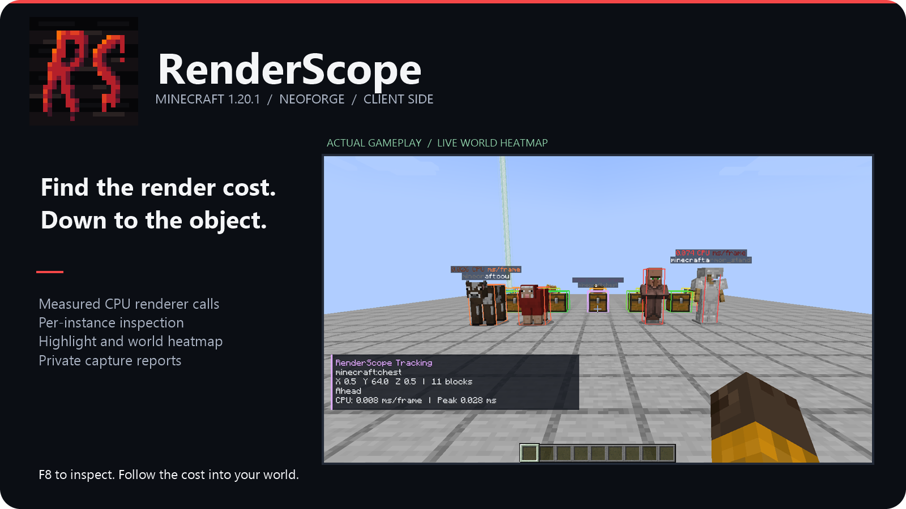
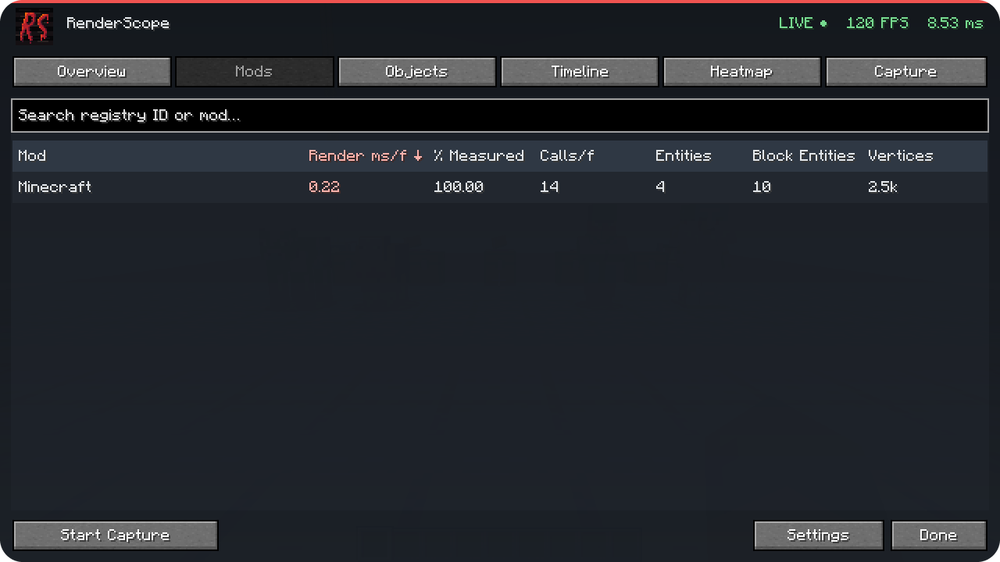
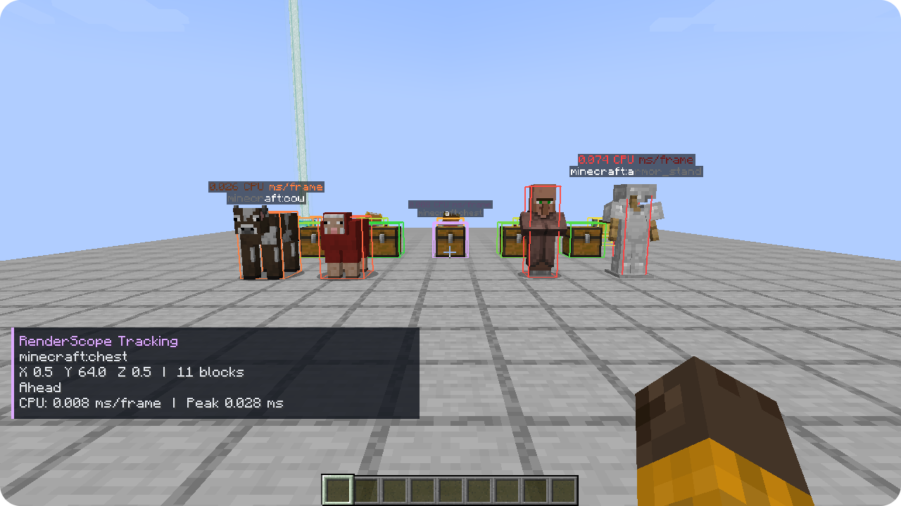

# RenderScope

**От времени рендера мода — до конкретного объекта в мире.**

**Minecraft 1.20.1 · NeoForge 47.1.106 · Java 21 · Только клиент**

RenderScope связывает измеренный рендер с модом, типом объекта и отдельным экземпляром мира. Выберите сущность или блок-сущность, посмотрите источники CPU-времени и подсветите объект, который хотите проверить.

---

## Найдите источник нагрузки

Откройте **F8** или **Esc → RenderScope**. В **Mods** выберите мод, в **Objects** — тип и экземпляр. Доступны среднее время, P95, пик, вызовы, класс реализации и раздельные источники CPU-работы.

## Увидьте его в мире

**Highlight** выделяет выбранный объект. **Track** показывает направление и расстояние. **Теплокарта** сравнивает стоимость измеренных экземпляров цветом, а **Inspect** отображает объект под прицелом. Настраиваются категории, дальность, порог стоимости, подписи и отображение сквозь стены.

## Запишите и сохраните

**Overview** показывает FPS, время кадра, процентили и измеренные источники нагрузки. **Timeline** хранит около 30 секунд истории. **Capture** записывает **5 / 10 / 30 секунд** или до ручной остановки и экспортирует JSON в папку `renderscope-reports` игрового профиля.

Отчёты остаются локальными. **Координаты и dimension по умолчанию выключены.** Имена игроков, серверы, имена миров, чат, UUID и абсолютные пути исключены. Включаются версии, список модов и измеренные источники и общие фазы CPU-работы.

---

## Установка

1. Используйте **Minecraft 1.20.1**, **NeoForge 47.1.106** и **Java 21**.
2. Положите `renderscope-neoforge-0.2.0+mc1.20.1.jar` в клиентскую папку `mods`. В профиле должен быть один RenderScope JAR для его загрузчика; MixinExtras уже включён.
3. Загрузите мир и нажмите **F8**. Клавиша меняется в стандартном меню управления.

**На сервер мод не нужен.** Есть русский и английский интерфейс; измерения продолжаются при закрытом меню.

## Что означают числа

**Timing Only** измеряет renderer calls, поддерживаемые Flywheel visual CPU-задачи и связанные deferred callbacks Mekanism. **Full** добавляет наблюдаемую BufferBuilder-геометрию и настоящие асинхронные GPU-измерения общих Flywheel batches на поддерживаемом контексте.

CPU-работа объекта и общие CPU/GPU-проходы показываются отдельно. Параллельные CPU-интервалы могут перекрываться; их сумма иногда больше длительности кадра. GPU-время и инстансированные вершины не распределяются по объектам. GPU-сводка остаётся живой диагностикой; в capture экспортируются источники и общие фазы CPU-работы. Estimated vertex data — не VRAM и не объём загрузок на GPU.

Необязательная visual-интеграция рассчитана на **Flywheel 1.0.5**. Виртуальные блок-сущности в подвижных конструкциях Create не получают отдельных мировых позиций; terrain, частицы, GUI и самостоятельные shader passes не входят в это покрытие. Backend автоматически не переключается.

NeoForge-сборка прошла собственные vanilla-проверки. Отдельная установленная Create/Mekanism сцена проверена на Forge; она не выдаётся за стороннюю проверку NeoForge.

---

## Исходники и лицензия

Используется **RenderScope Source-Available License 1.0**. Разрешены личное и бесплатное использование, изменения, бесплатное распространение и включение в бесплатные проекты по условиям лицензии. **Продажа мода/кода, включение в платные проекты/модпаки/комплекты и платный доступ требуют предварительного письменного разрешения владельца.** Личное использование как инструмента, в том числе на работе, разрешено. При распространении сохраняйте лицензию и обязательные уведомления, а изменённые версии отмечайте. Добровольные пожертвования без условия доступа и обычная реклама на свободно доступной странице разрешены.

[Исходный код](https://github.com/AlexFirst404/RenderScope) · [Полный текст лицензии](https://github.com/AlexFirst404/RenderScope/blob/main/LICENSE)
