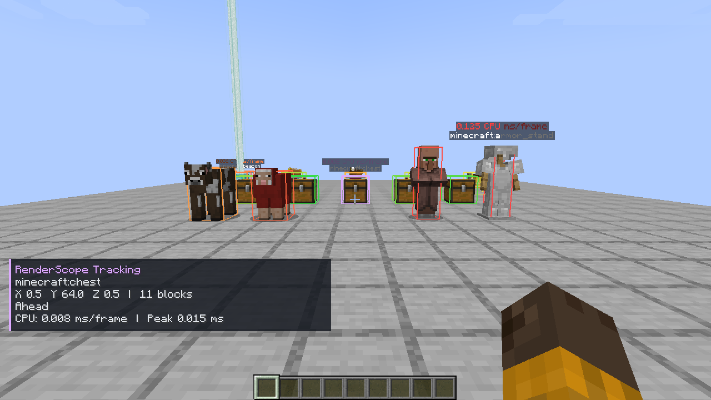
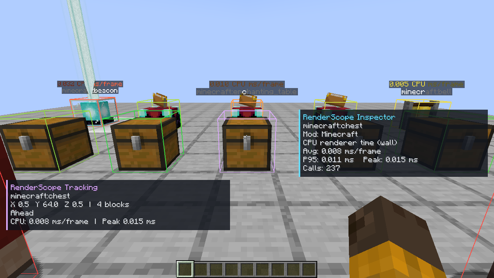
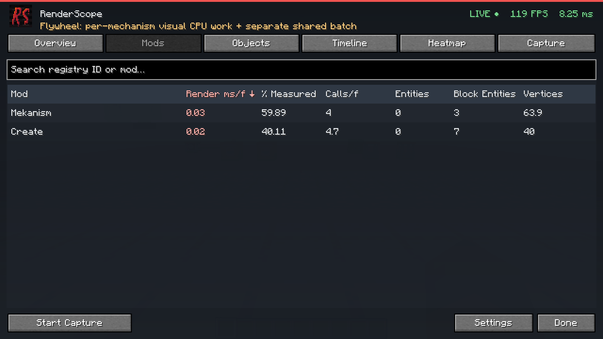
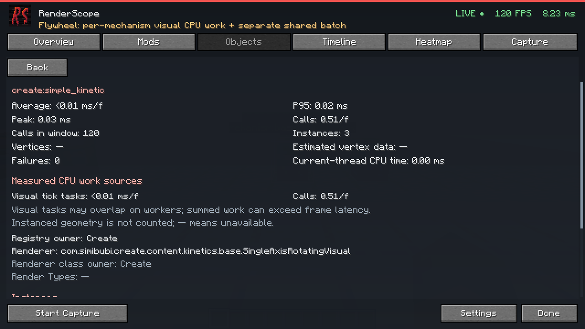
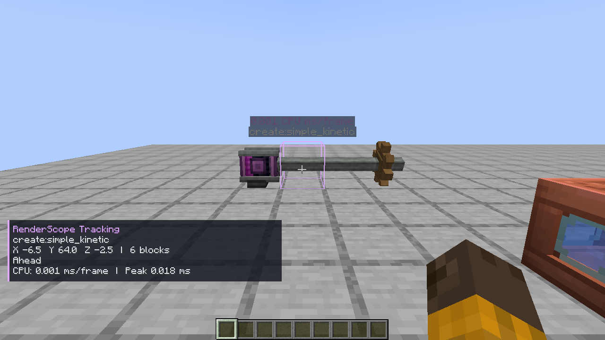

# RenderScope 0.2.0

**От времени рендера мода — до конкретного объекта в мире.**

RenderScope — клиентский профилировщик для **Minecraft 1.20.1 / Forge 47.4.10**. Он измеряет реальные вызовы рендереров сущностей и блок-сущностей и помогает найти экземпляр, который стоит проверить в проблемной сцене.

## Найдите объект и подсветите его

Откройте **F8** или **Esc → RenderScope**. В **Mods** выберите мод, в **Objects** — тип объекта, затем конкретный экземпляр по координатам. **Highlight** выделяет его в мире на заданное время, **Track** сохраняет отслеживание, **Copy Position** копирует позицию.

**Теплокарта** показывает сравнительную стоимость измеренных объектов цветом: зелёный — ниже, жёлтый — выше, красный — самые дорогие 5% текущего набора. Доступны отдельные фильтры сущностей и блок-сущностей, дальность, лимит объектов, минимальная стоимость, подписи и отображение сквозь стены.

Включите **Inspect**, чтобы видеть данные профилированного объекта под прицелом.

## Данные прямо во время игры

- FPS, время кадра, 1% low, P50/P95/P99 и худший кадр.
- Сортируемые таблицы модов и объектов с поиском, средним временем, P95, пиком, вызовами и экземплярами.
- Registry owner и владелец класса рендерера как отдельные значения.
- Примерно 30 секунд живой истории с выбором реального кадра и его измеренных источников нагрузки.
- Записи на 5, 10, 30 секунд или вручную; итоговая сводка и экспорт JSON.
- Режимы Timing Only / Full, настраиваемое окно статистики и английский/русский интерфейс.

Профилировщик работает и при закрытом меню. По умолчанию статистика охватывает последние пять секунд. Клавиша F8 меняется в стандартном меню управления Minecraft.

## В игре

Настоящий локальный мир с vanilla-объектами; числа относятся к этой сцене и зависят от оборудования.

## Что именно измеряется

Основной таймер показывает **прошедшее CPU-side время renderer calls и поддерживаемых visual-задач**. Параллельная CPU-работа суммируется по фактическим интервалам выполнения, поэтому сумма может превышать длительность кадра. GPU-измерение общей Flywheel-фазы показывается отдельно; это не вся стоимость рендера Minecraft: terrain, частицы, GUI и отдельные шейдерные проходы не входят в атрибуцию этого MVP.

В **Full** дополнительно наблюдаются вершины стандартного BufferBuilder и запросы RenderType через BufferSource. Собственные рендер-пайплайны модов могут обходить эти счётчики. **Estimated vertex data** — оценка наблюдаемой геометрии, а не VRAM и не объём загрузок на GPU. Основной режим **Timing Only** сохраняет измерения времени без сбора геометрии.

Необязательная интеграция **Mekanism 10.4.16.80** связывает отложенную полупрозрачную отрисовку с экземпляром, чей рендерер поставил её в очередь. Измеряется последующий реальный вызов callback и его наблюдаемая геометрия; сама регистрация в очереди не создаёт выдуманного времени. В Timing Only время продолжает собираться. Для использования RenderScope установка Mekanism не требуется.

**Новое в 0.2.0: Flywheel 1.0.5.** CPU-задачи создания, frame, tick, update и light visuals связываются с настоящими экземплярами мира при включённом instancing. Источники времени показывают обычные renderers и visual callbacks отдельно; экземпляр механизма можно выбрать и подсветить. Общая отправка batch имеет собственную CPU-фазу.

В **Full** настоящие асинхронные OpenGL timestamp queries измеряют общие Flywheel GPU-интервалы на поддерживаемом контексте. Живая сводка охватывает завершённые измеренные Flywheel-кадры примерно за пять секунд, без ожидания после каждого объекта. В **Timing Only** GPU queries выключены. В JSON сохраняются CPU sources и shared phases; GPU-диагностика остаётся живой. Per-object GPU-время и инстансированная геометрия не придумываются и не распределяются между экземплярами. Виртуальные block entities contraption по-прежнему не получают отдельных мировых позиций и подсветки. Backend автоматически не переключается.

Версия **0.2.0 прошла сценарий в установленном Forge-профиле с production JAR** с **Create 6.0.8 / Flywheel 1.0.5 / Ponder 1.0.91 и Mekanism 10.4.16.80**: вращающиеся мотор/вал/шестерню, анимированный пресс, заполненные баки и заряженный energy cube. Подтверждены настоящие visual CPU sources при включённом instancing, shared CPU/GPU batch, Full/Timing Only, индивидуальная подсветка, heatmap, capture/privacy и очистка после удаления/recreate/disconnect. Это проверка выбранной сцены и закреплённых версий.

Суммы модов группируются по namespace registry ID. Класс реализации указан отдельно; определить автора каждой mixin-инъекции внутри чужого класса таким способом невозможно.

## Установка и отчёты

Нужны **Minecraft 1.20.1**, **Forge 47.4.10** и **Java 21**. Поместите `renderscope-forge-0.2.0+mc1.20.1.jar` в клиентскую папку `mods` профиля Forge. MixinExtras включён в дистрибутив. NeoForge-сборка сохранена отдельно; в одном профиле используйте только один RenderScope JAR для его загрузчика.

**На сервер мод устанавливать не нужно.** RenderScope не требует собственной сетевой части и не изменяет выделяемые объекты.

JSON сохраняется локально в `renderscope-reports`. Он содержит версии игры, загрузчика и RenderScope, названия/версии модов и измеренные метрики. Имена игроков, серверы, имена миров, чат, UUID и абсолютные пути исключены. Координаты и dimension выключены по умолчанию и добавляются только после включения **Include world positions**. Автоматической отправки отчётов нет.
