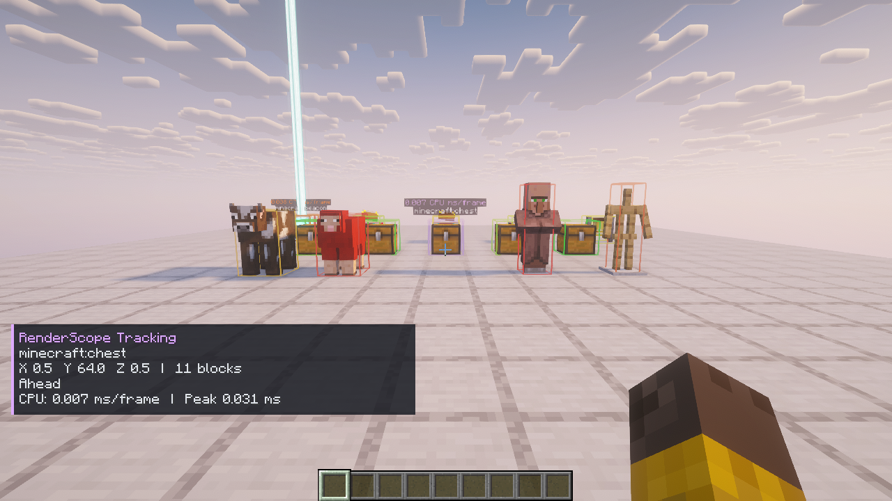
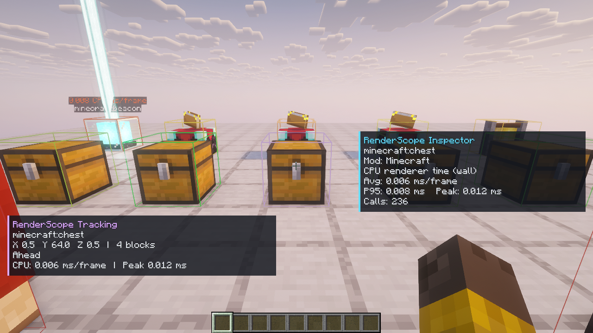

# Iris / Sodium · Minecraft 1.21.8

Проверен установленный production JAR RenderScope 0.3.0 в реальном клиенте Fabric 0.19.5 с Sodium 0.7.2, Iris 1.9.6 и **включённым** Complementary Reimagined r5.9.3. Точные версии, источники и контрольные суммы находятся в [compatibility-profile.json](compatibility-profile.json).

Прошли реальные CPU-замеры Entity и BlockEntity в Full и Timing Only, наблюдение теневого прохода через Iris API, пятисекундная запись, экспорт с проверкой приватности, F8, меню паузы, выбор и отслеживание объекта, Inspector и 28 снимков экрана. В записи — 594 кадра за 5.0043181 секунды; это проверка работоспособности, а не сравнительный тест FPS.

Визуально проверены 14 цветных рамок, их совпадение с объектами и читаемые подписи. Хэш фактически измеренного JAR, JSON-результата, capture и просмотренных изображений записан в [visual-qa.json](visual-qa.json); запуск подтверждён [installed-verification.json](installed-verification.json).

## Граница измерений

Нативные буферы Sodium 0.7.2 и Iris 1.9.6 на этой версии Minecraft не инструментированы. Их счётчики геометрии помечены как **недоступные**. Небольшое число вершин, замеченных в обычном BufferBuilder, не описывает всю геометрию сцены. Персональное GPU-время объектов не заявляется.

Первый просмотр выявил невидимые рамки при включённых шейдерах. Исправление назначает обеим пользовательским линиям программу `LINES` через [публичный API Iris](https://raw.githubusercontent.com/IrisShaders/Iris/c86b6a250ed1bb85bbcad6404fae99fc08be6c68/common/src/api/java/net/irisshaders/iris/api/v0/IrisApi.java). Во время итогового запуска API подтвердил две регистрации без ошибок; свежие изображения подтвердили видимость рамок. Привязка ограничена точной версией Minecraft 1.21.8 / Iris 1.9.6.

Проверка относится к указанной связке и сцене. Другие шейдерпаки, версии модов и загрузчики требуют отдельных запусков.
