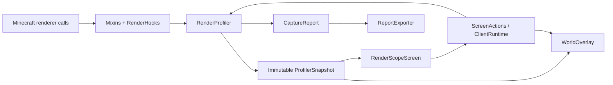

# Архитектура RenderScope 0.1.0

Релиз рассчитан на Minecraft **1.20.1** и NeoForge **47.1.106**. Упоминания API 1.21.1 в исходном задании не меняют целевую версию: точки вызовов, сигнатуры GUI и события проверяются для 1.20.1.

Для этой исторической ветки загрузчика корректны Maven-координаты [`net.neoforged:forge:1.20.1-47.1.106`](https://maven.neoforged.net/releases/net/neoforged/forge/1.20.1-47.1.106/), пакеты `net.minecraftforge` и ID зависимости `forge` в metadata. Актуальная архитектура другого поколения NeoForge не подставляется вместо них. Справочные материалы для общих API этого поколения: [официальная документация Forge 1.20.1](https://docs.minecraftforge.net/en/1.20.1/) и [Screens / GuiGraphics 1.20.1](https://docs.minecraftforge.net/en/1.20.1/gui/screens/). Итоговые сигнатуры сверяются с реально разрешёнными артефактами сборки.

## Разделение слоёв

| Слой | Ответственность |
| --- | --- |
| `dev.renderscope.core` | Измерения, окна статистики, агрегация, timeline, capture, неизменяемые значения |
| `dev.renderscope.mixin` | Инструментирование точных Minecraft-вызовов, для которых обычного события недостаточно |
| `dev.renderscope.client.RenderHooks` | Преобразование игровых объектов в value records, границы кадра и renderer scope |
| `ClientRuntime` | Регистрация событий, key mapping, применение настроек и выполнение действий UI |
| `ModOwnership` | Разрешение имени мода и отдельного владельца класса рендерера |
| `client.ui` | Native Minecraft Screen, таблицы, поиск, сортировка, подробности и управление |
| `client.world` | Подсветка, отслеживание, теплокарта и HUD инспектора |
| `client.report` | Экспорт по явному списку разрешённых полей |

В `core` нет импортов Minecraft или NeoForge. Будущий адаптер Fabric может создавать те же `SampleContext`, вызывать границы кадра/вызова и читать те же snapshots. Это граница переносимости, а не заявление о наличии готовой Fabric-сборки.

## Точные точки измерения

`EntityRenderDispatcherMixin` оборачивает `EntityRenderer.render(...)` внутри мирового `EntityRenderDispatcher.render`. `BlockEntityRenderDispatcherMixin` оборачивает `BlockEntityRenderer.render(...)` внутри `BlockEntityRenderDispatcher.setupAndRender`.

Обе обёртки используют MixinExtras `WrapOperation`: исходный вызов выполняется с неизменёнными аргументами, завершение измерения находится в `finally`, исключение сохраняет обычное поведение Minecraft. Не подменяются renderer, `VertexConsumer` или `MultiBufferSource` стороннего мода. При вложенном инструментированном вызове `excludeNestedCall` исключает его сырой интервал из родительского wall/CPU time, сохраняя exclusive-атрибуцию без двойного учёта потомков.

`MinecraftMixin` отмечает начало и возврат `Minecraft.runTick`. `RenderLevelStageEvent` ограничивает сбор отдельных рендереров мировым проходом; инвентарные и другие сторонние отрисовки через тот же dispatcher за пределами этого прохода не становятся мировыми экземплярами.

В Full mode `BufferBuilderMixin` наблюдает завершение `endVertex` и размер текущего vertex format; `BufferSourceMixin` наблюдает `BufferSource.getBuffer(RenderType)`. Эти счётчики привязаны к активному scope. Timing Only отключает сбор геометрии, сохраняя измерения времени.

## Данные и срок жизни

`SampleContext` содержит registry ID, два владельца, имя класса, ключ экземпляра, позицию и bounds. Ключ блок-сущности состоит из категории, dimension и позиции. Для entity используется локальный числовой ID; UUID не нужен. Долговременные записи ядра не держат `Entity`, `BlockEntity`, world, renderer или consumer.

Новый мир либо смена dimension вызывают `RenderProfiler.clear()` и `WorldOverlay.clear()`. Поколение сессии предотвращает добавление позднего результата старого вызова в новую сессию. Повторное завершение одного token игнорируется.

Методы ядра синхронизированы. Snapshot и все его коллекции неизменяемы. Снимок кэшируется на 250 мс; экран читает снимок при обновлении, а не получает изменяемое состояние для каждой строки. Сбор не зависит от наличия открытого экрана.

Память ограничена: максимум 4 096 экземпляров на кадр, 8 192 кадров и 262 144 записей экземпляров в rolling history, 4 096 ключей в каждой capture-агрегации. Timeline хранит около 300 точек за 30 секунд. Длинный capture имеет ограниченный timeline с постепенным укрупнением интервалов. При достижении лимитов `droppedMeasurements` отражает потерю детализации.

## Атрибуция

Основная группировка Mods использует namespace registry ID. Через ModList namespace разрешается в отображаемое имя; Minecraft и неизвестный владелец имеют явные fallback-имена.

Владелец класса рендерера определяется отдельно по пакету класса и пакетам загруженных mod files. Для классов Minecraft используется `minecraft`. Если один mod file содержит несколько mod IDs, пакет связывается с первым ID файла: это доступная атрибуция реализации, а не доказательство авторства каждой инструкции.

Mixin, внедрённый в класс другого мода или Minecraft, не меняет Java-класс этого рендерера. RenderScope не может приписать время каждой mixin-инъекции её автору. Именно поэтому registry owner и renderer class owner не объединяются в одно якобы точное значение.

## Клиентский UI и оверлеи

Экран построен на `Screen`, `GuiGraphics`, стандартных `Button` и `EditBox`, с прокручиваемыми таблицами. Разметка пересчитывается в `init()` при изменении размера. Тяжёлый GUI framework не используется. `isPauseScreen()` возвращает `false`.

F8 регистрируется обычным `KeyMapping` через `RegisterKeyMappingsEvent`. Кнопка в меню паузы добавляется через `ScreenEvent.Init.Post`; существующий PauseScreen сохраняется.

Подсветка выполняется через `RenderLevelStageEvent.Stage.AFTER_PARTICLES`, где эта версия загрузчика передаёт нужный camera pose. Стадия `AFTER_LEVEL` в NeoForge 47.1.106 имеет другую матрицу и не используется для мировых bounding boxes. У оверлея собственный buffer source: он не сбрасывает общие буферы чужих рендереров. Состояние GL и pose stack восстанавливаются. Entity bounds разрешаются по текущему ID непосредственно перед отрисовкой; в записи остаются только значения. Теплокарта учитывает категорию, расстояние, порог стоимости и лимит объектов. Для подписей проецируются экранные границы: пересекающиеся подписи, выход за край и наложение на HUD пропускаются с приоритетом выбранного и дорогих объектов. Число подписей дополнительно ограничено 32; bounding boxes при этом сохраняются.

## Отчёты, зависимости, сборка

`ReportExporter` вручную выбирает поля JSON. Он не сериализует сырые ключи экземпляров и игровые объекты. Dimension и position добавляются только при явном opt-in; имя игрока, сервер, мир, чат, UUID и абсолютные пути не запрашиваются для отчёта. Файл записывается локально, автоматической отправки нет.

Gradle 8.8 и JDK 21 создают Java 17 bytecode для загрузчика 1.20.1. MixinExtras включён в основной JAR через Jar-in-Jar; `-slim` не является самостоятельным дистрибутивом. Код тестового smoke-сценария и материалы публикации не должны попадать в release JAR.

GPU queries, VRAM/texture-memory accounting, профилирование terrain, particles, item/GUI renderers и отдельные shader phases не включены в этот релиз. Ядро и типизированный `ObjectKind` оставляют отдельную точку для расширения категорий.
