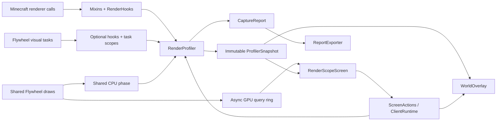

# Архитектура RenderScope 0.3.0

Версия 0.3.0 содержит отдельные адаптеры для стабильных Minecraft **1.20.1–26.3** и доступных для них Fabric, Forge и NeoForge. [Матрица](compatibility/SUPPORT-MATRIX.md) связывает каждую цель с фактическим артефактом, тестами и игровым результатом по SHA-256. Отсутствующие upstream-выпуски Forge для 1.20.5 и 1.21.2 не подменяются соседними версиями.

Корневой Gradle-проект сохраняет исходные цели **Minecraft 1.20.1**: **Forge 47.4.10** и **NeoForge 47.1.106**. Выбор по умолчанию — `forge`; `-Ploader=neoforge` выбирает исходный NeoForge. Следующая таблица относится к этим двум адаптерам.

| Выбор | Зависимость Minecraft/loader | Каталог сборки | Дистрибутив |
| --- | --- | --- | --- |
| `forge` | `net.minecraftforge:forge:1.20.1-47.4.10` | `build/forge/` | `distribution/0.3.0/forge/renderscope-forge-0.3.0+mc1.20.1.jar` |
| `neoforge` | `net.neoforged:forge:1.20.1-47.1.106` | `build/neoforge/` | `distribution/0.3.0/neoforge/renderscope-neoforge-0.3.0+mc1.20.1.jar` |

Forge 47.4.10 выбран из категории **Recommended** на [официальной странице Forge для 1.20.1](https://files.minecraftforge.net/net/minecraftforge/forge/index_1.20.1.html), проверенной 20 октября 2026 года. NeoForge остаётся на [исходном артефакте 47.1.106](https://maven.neoforged.net/releases/net/neoforged/forge/1.20.1-47.1.106/). Раздельные build/output каталоги изолируют классы, refmap, ресурсы, тестовые результаты и reobfuscation двух загрузчиков.

Пакеты `net.minecraftforge` и ID зависимости `forge` корректны для обеих этих веток 1.20.1. Общий адаптер Minecraft использует их существующие совместимые точки API; код профилировщика и UI не дублируется. Справочные материалы: [официальная документация Forge 1.20.1](https://docs.minecraftforge.net/en/1.20.1/) и [Screens / GuiGraphics 1.20.1](https://docs.minecraftforge.net/en/1.20.1/gui/screens/). Итоговые сигнатуры сверяются с фактически разрешёнными артефактами каждой цели.

## Разделение слоёв

| Слой | Ответственность |
| --- | --- |
| `dev.renderscope.core` | Измерения, окна статистики, агрегация, timeline, capture, неизменяемые значения |
| `dev.renderscope.mixin` | Инструментирование точных Minecraft-вызовов, для которых обычного события недостаточно |
| `dev.renderscope.client.RenderHooks` | Преобразование игровых объектов в value records, границы кадра и renderer scope |
| `client.integration.FlywheelHooks` | Weak visual associations, CPU task scopes, перенос frame handle в executors, общая batch-фаза |
| `FlywheelGpuTimers` | Ограниченное асинхронное кольцо общих GPU timestamps; отдельная живая сводка |
| `ClientRuntime` | Применение настроек, состояние клиента и выполнение действий UI |
| `client.platform` | Реальные сведения о загрузчике, модах, владельцах классов и каталогах через `PlatformAccess` |
| `ForgeClientBootstrap` / Fabric bootstrap | Регистрация подходящих событий загрузчика и key mapping |
| `DiagnosticEngine` | Интерпретация неизменяемого snapshot: дорогой мод, тип, экземпляр, готовность выборки и ограничения измерений |
| `LoaderInfo` | Фактическое имя и версия загруженного Forge/NeoForge для логов, smoke-проверки и JSON |
| `ModOwnership` | Разрешение имени мода и отдельного владельца класса рендерера |
| `client.ui` | Native Minecraft Screen, таблицы, поиск, сортировка, подробности и управление |
| `client.world` | Подсветка, отслеживание, теплокарта и HUD инспектора |
| `client.report` | Экспорт по явному списку разрешённых полей |

В `core` нет импортов Minecraft, Forge, NeoForge или Fabric. Все адаптеры создают одинаковые `SampleContext`, вызывают границы кадра/вызова и читают неизменяемые snapshots. GUI не владеет профилировщиком и не останавливает сбор при закрытии.

## Семейства API и загрузчики

`fabric/` содержит Fabric 1.20.1, `mc20/` — следующие 1.20.x, `mc21/` — 1.20.5–1.21.8, `modern/` — render-state API 1.21.9–26.3. `forge20/`, `neo20/`, `loader21/`, `loader-mapped/` и `loader26/` добавляют соответствующие нативные загрузчики. Конкретные выборки исходников и преобразования ограничены точной версией; один универсальный Mixin не применяется к несовместимым сигнатурам.

В render-state API подготовка состояния и отправка измеряются отдельно (`RENDER_EXTRACTION`, `RENDER_SUBMISSION`). Ограниченная weak identity-таблица связывает настоящий state с value-контекстом экземпляра в пределах кадра. Она не хранит сильные ссылки на сущности и очищается на границе кадра/мира. Недоступная геометрия и per-object GPU-стоимость явно остаются недоступными.

Minecraft 26.x запускается на Java 25. Нативные Forge/NeoForge адаптеры компилируются JDK 25 в Java 21 bytecode, соответствующий языковому уровню официального Sponge Mixin; это не меняет Java 25 requirement игры. Fabric использует свой проверенный уровень. Подробности — в [loader26](../loader26/README.md).

Отдельные QA-моды создают реальные миры, используют native widgets/input и проверяют фактически загруженный JAR. В production JAR нет QA-классов; пакеты и Mixin-конфигурация QA изолированы, включая JPMS-пакеты новых загрузчиков. Подготовленный клиент и успешная компиляция сами по себе не считаются игровым тестом.

## Точные точки измерения Minecraft 1.20.1

`EntityRenderDispatcherMixin` оборачивает `EntityRenderer.render(...)` внутри мирового `EntityRenderDispatcher.render`. `BlockEntityRenderDispatcherMixin` оборачивает `BlockEntityRenderer.render(...)` внутри `BlockEntityRenderDispatcher.setupAndRender`.

Обе обёртки используют MixinExtras `WrapOperation`: исходный вызов выполняется с неизменёнными аргументами, завершение измерения находится в `finally`, исключение сохраняет обычное поведение Minecraft. Не подменяются renderer, `VertexConsumer` или `MultiBufferSource` стороннего мода. При вложенном инструментированном вызове `excludeNestedCall` исключает его сырой интервал из родительского wall/CPU time, сохраняя exclusive-атрибуцию без двойного учёта потомков.

`MinecraftMixin` отмечает начало и возврат `Minecraft.runTick`. `RenderLevelStageEvent` ограничивает сбор отдельных рендереров мировым проходом; инвентарные и другие сторонние отрисовки через тот же dispatcher за пределами этого прохода не становятся мировыми экземплярами.

В Full mode `BufferBuilderMixin` наблюдает завершение `endVertex` и размер текущего vertex format; `BufferSourceMixin` наблюдает `BufferSource.getBuffer(RenderType)`. Эти счётчики привязаны к активному scope. Timing Only отключает сбор геометрии, сохраняя измерения времени.

### Необязательная интеграция Mekanism

`MekanismDeferredRenderMixin` использует `@Pseudo` и строковый target `mekanism.client.render.RenderTickHandler`; зависимость от Mekanism в production classpath не добавляется. Точки сверены с артефактом **Mekanism-1.20.1-10.4.16.80.jar**: регистрация `addTransparentRenderer(RenderType, LazyRender)` и реальный вызов `LazyRender.render(...)` в `lambda$renderWorld$1`. Изменённые версии этих внутренних методов требуют отдельной проверки.

При регистрации задача связывается с value-only `SampleContext` активного мирового BER. `DeferredContexts` хранит не более 4 096 weak identity keys за кадр, копирует только контекст и имена RenderType и очищается на границах кадра/сессии. Ключи сравниваются по identity, а не по пользовательскому `equals`. Если один callback используется разными экземплярами, связь признаётся неоднозначной и не получает придуманного владельца; потеря ассоциации отмечается через `droppedMeasurements`.

Во время последующего вызова открывается новый scope того же экземпляра и исходного класса рендерера. `finally` завершает реальное измерение и сохраняет исключение. Время подготовки BER и время отложенного callback — два неперекрывающихся измеренных вызова. Обычный механизм `excludeNestedCall` также применяется, если callback оказался вложенным. Запрошенный при постановке в очередь RenderType переносится в scope, поскольку сам consumer может быть получен до его открытия. Timing Only собирает время без геометрии. Чужие callbacks, поставленные вне измеренного мирового scope, не приписываются случайному объекту.

Диагностические счётчики `RenderHooks.queuedDeferredCalls()`, `renderedDeferredCalls()` и `measuredDeferredCalls()` содержат только накопительные числа за текущую мировую сессию. Они позволяют проверить, что настоящая очередь, callback и атрибуция были задействованы. В точном Mekanism-артефакте этот путь используют в том числе RenderEnergyCube и RenderIndustrialAlarm; обычные FluidTank/DynamicTank рендерят жидкость непосредственно и сами по себе не доказывают работу deferred hook.

### Необязательная интеграция Create / Flywheel

В **Create 6.0.8 / Flywheel 1.0.5** обычный KineticBlockEntityRenderer может сразу вернуть управление при активном visualization backend. В 0.2.0 дополнительные необязательные hooks измеряют CPU-работу visuals вне BER. `Storage.createRaw` связывает visual с исходным реальным клиентским BE/entity; weak identity map ограничен 8 192 записями. Ссылка на источник также слабая, в контексте остаются значения. Association создаётся и при выключенном профилировании; delete/rebuild и смена сессии удаляют связь.

Простые `SimpleDynamicVisual.beginFrame` и `SimpleTickableVisual.tick` измеряются непосредственно. Для других Plan-задач scoped TaskExecutor wrappers измеряют интервалы фактического выполнения с исключением completion continuation. Serial/parallel executors переносят `FrameHandle`; `ScheduledContext` переносит также явное отсутствие кадра, поэтому задача, поставленная при выключенном сборе, не захватывает случайно последующий кадр. Поздняя работа другого кадра или поколения сессии не попадает в новые данные. Это сумма наблюдаемой CPU-работы, а не scheduling-to-completion latency. Параллельные интервалы могут перекрываться, поэтому их сумма может превышать wall time кадра.

`Statistics.sources` разделяет обычные renderers и visual create/frame/tick/update/light. Renderer aggregates сохраняют каждый фактический implementation class: обычный BER и visual одного BE не скрывают друг друга. CPU-атрибуция относится к исходному registry owner, владелец visual-класса хранится отдельно.

После join задач `Engine.render` обёрнут отдельной `PhaseMetric` с ID `flywheel:batch_submit` и source `FLYWHEEL_BATCH_SUBMIT`. Общая CPU-фаза не создаёт фиктивный объект и не добавляется к каждому модовому/instance total. Геометрия per-visual instancing не выводится из количества объектов: Full продолжает считать только наблюдаемые BufferBuilder vertices.

`FlywheelGpuTimers` ставит парные `GL_TIMESTAMP` queries вокруг общей batch-фазы только в Full. Ограничение — 64 пары; чтение отложено до `GL_QUERY_RESULT_AVAILABLE`. Занятые слоты пропускаются, без `glFinish` или блокирующего ожидания. Среднее/пик используют завершённые измеренные Flywheel-кадры за пять секунд; текущие/неполные кадры исключены. GPU-метрика не распределяется по экземплярам и остаётся живой диагностикой UI. В capture экспортируются CPU `sources` и отдельные `phases`, без притворного GPU-capture.

Create `BlockEntityRenderHelper` вызывает BER напрямую для виртуальных block entities contraption, минуя наш dispatcher hook. Их локальные позиции не являются координатами блоков основного мира. Эти дочерние экземпляры не получают отдельной атрибуции/подсветки; обычная внешняя contraption entity остаётся измеряемой, если проходит через EntityRenderDispatcher. Фильтр `entity.getLevel() == Minecraft.level` дополнительно защищает от записи virtual/inventory объектов как физических мировых блоков. Это осознанная граница текущей модели, требующая отдельного родительского instance/transform adapter для расширения.

Проверенные первичные точки: [Create KineticBlockEntityRenderer 6.0.8](https://github.com/Creators-of-Create/Create/blob/mc1.20.1-6.0.8/src/main/java/com/simibubi/create/content/kinetics/base/KineticBlockEntityRenderer.java), [Create BlockEntityRenderHelper 6.0.8](https://github.com/Creators-of-Create/Create/blob/mc1.20.1-6.0.8/src/main/java/com/simibubi/create/foundation/render/BlockEntityRenderHelper.java), [Mekanism RenderTickHandler 1.20.x](https://github.com/mekanism/Mekanism/blob/1.20.x/src/main/java/mekanism/client/render/RenderTickHandler.java). Mekanism selector дополнительно сверяется с bytecode точного release JAR.

## Данные и срок жизни

`SampleContext` содержит registry ID, два владельца, имя класса, ключ экземпляра, позицию и bounds. Ключ блок-сущности состоит из категории, dimension, позиции и registry ID BlockEntityType. `SampleContext` нормализует его даже для адаптеров с совместимым трёхаргументным конструктором. При замене блока другим registry type их статистика остаётся раздельной в rolling window и capture; Inspector сверяет тип реально находящегося в позиции блока. Для entity старые адаптеры используют локальный числовой ID, а современные добавляют UUID в непрозрачный внутренний ключ; UUID не показывается и не экспортируется. Долговременные записи ядра не держат `Entity`, `BlockEntity`, world, renderer или consumer.

Новый мир либо смена dimension вызывают `RenderProfiler.clear()` и `WorldOverlay.clear()`. Поколение сессии предотвращает добавление позднего результата старого вызова в новую сессию. Повторное завершение одного token игнорируется.

Методы ядра синхронизированы. Snapshot и все его коллекции неизменяемы. Снимок кэшируется на 250 мс; экран читает снимок при обновлении, а не получает изменяемое состояние для каждой строки. Сбор не зависит от наличия открытого экрана.

Память ограничена: максимум 4 096 экземпляров на кадр, 8 192 кадров и 262 144 записей экземпляров/групп в rolling history, 4 096 ключей в каждой capture-агрегации. Timeline хранит около 300 точек за 30 секунд. Длинный capture имеет ограниченный timeline с постепенным укрупнением интервалов. При достижении лимитов `droppedMeasurements` отражает потерю детализации.

## Атрибуция

Основная группировка Mods использует namespace registry ID. Через ModList namespace разрешается в отображаемое имя; Minecraft и неизвестный владелец имеют явные fallback-имена.

Владелец класса рендерера определяется отдельно по пакету класса и пакетам загруженных mod files. Для классов Minecraft используется `minecraft`. Если один mod file содержит несколько mod IDs, пакет связывается с первым ID файла: это доступная атрибуция реализации, а не доказательство авторства каждой инструкции.

Mixin, внедрённый в класс другого мода или Minecraft, не меняет Java-класс этого рендерера. RenderScope не может приписать время каждой mixin-инъекции её автору. Именно поэтому registry owner и renderer class owner не объединяются в одно якобы точное значение.

## Клиентский UI и оверлеи

Экран построен на `Screen`, `GuiGraphics`, стандартных `Button` и `EditBox`, с прокручиваемыми таблицами. Разметка пересчитывается в `init()` при изменении размера. Тяжёлый GUI framework не используется. `isPauseScreen()` возвращает `false`.

F8 регистрируется обычным `KeyMapping` через `RegisterKeyMappingsEvent`. Кнопка в меню паузы добавляется через `ScreenEvent.Init.Post`; существующий PauseScreen сохраняется.

Подсветка выполняется через `RenderLevelStageEvent.Stage.AFTER_PARTICLES`, где эта версия загрузчика передаёт нужный camera pose. Стадия `AFTER_LEVEL` в NeoForge 47.1.106 имеет другую матрицу и не используется для мировых bounding boxes. У оверлея собственный buffer source: он не сбрасывает общие буферы чужих рендереров. Состояние GL и pose stack восстанавливаются. Entity bounds разрешаются по текущему ID непосредственно перед отрисовкой; в записи остаются только значения. Теплокарта учитывает категорию, расстояние, порог стоимости и лимит объектов. Для подписей проецируются экранные границы: пересекающиеся подписи, выход за край и наложение на HUD пропускаются с приоритетом выбранного и дорогих объектов. Число подписей дополнительно ограничено 32; bounding boxes при этом сохраняются.

## Отчёты, зависимости, сборка

`ReportExporter` вручную выбирает поля JSON. Имя и версия загрузчика берутся из runtime `LoaderInfo`, поэтому Forge-capture содержит Forge и его действительную версию, а NeoForge-capture — NeoForge. Экспортёр не сериализует сырые ключи экземпляров и игровые объекты. Dimension и position добавляются только при явном opt-in; имя игрока, сервер, мир, чат, UUID и абсолютные пути не запрашиваются для отчёта. Файл записывается локально, автоматической отправки нет.

Gradle 8.8 и JDK 21 создают Java 17 bytecode для загрузчиков 1.20.1; требование Java 21 для запуска профиля сохраняется. MixinExtras включён в основной JAR через Jar-in-Jar; `-slim` не является самостоятельным дистрибутивом. В одном клиентском профиле используется только один RenderScope JAR, соответствующий его загрузчику.

`scripts/build.ps1 -Loader forge|neoforge` передаёт Gradle `-Ploader=<цель>`, выбирает JDK 21 и копирует готовый JAR в нужный дистрибутив. Необязательный `-Smoke` запускает настоящий тестовый клиент. Source set `smoke` не входит в release JAR. Рабочие профили `run-smoke-forge/` и `run-smoke-neoforge/` раздельны; каждый запуск сохраняет собственные отчёт, capture и gallery в каталоге своего дистрибутива. Наличие NeoForge-галереи не считается доказательством проверки Forge.

`scripts/verify-release.py --loader forge|neoforge` проверяет текущий JAR, `build/<loader>/test-results/test` и фактический loader/version в JSON capture. `mod_version` и `minecraft_version` берутся из `gradle.properties`, поэтому сохранённые старые JAR не выбираются вместо текущего. `scripts/package-release.py` проверяет release metadata и пиксельные ассеты, затем создаёт `renderscope-forge-0.2.0-publication.zip` либо `renderscope-0.2.0-publication.zip`. Исторические основные 0.1.0 JAR остаются на диске, но исключаются из нового ZIP; неизвестные JAR и test harness в материалах приводят к отказу упаковки.

Source set `compat` запускается командой `gradlew.bat -Ploader=forge runCompatClient`; отдельная `compatJar` создаёт reobfuscated `renderscope-forge-0.2.0+mc1.20.1-compat-harness.jar`. Сценарий использует настоящие fixtures **Create 6.0.8 / Flywheel 1.0.5 / Ponder 1.0.91 и Mekanism 10.4.16.80**. Заполненные баки, заряженный energy cube, вращающиеся мотор/вал/шестерня и анимированный пресс создают настоящие renderer/visual callbacks; синтетические измерения не записываются.

Проверяются отдельные источники: motor `FLYWHEEL_VISUAL_UPDATE`, shaft/cogwheel `FLYWHEEL_VISUAL_TICK`, press `FLYWHEEL_VISUAL_FRAME`. В обоих режимах требуются положительные реальные CPU-интервалы; per-visual vertices и estimated bytes остаются нулевыми. При активном default backend проверяются shared CPU phase и завершённые Full GPU queries; Timing Only должен выключить queries. Дополнительно проверяются fallback `flywheel:off`, восстановление backend, отдельные highlights/labels, heatmap четырёх механизмов, удаление/recreate visual и очистка после настоящего disconnect. Сценарий сохраняет 11 игровых PNG.

`scripts/test-installed-client.py` готовит изолированный Windows-профиль из официальных Forge installer/Mojang manifests и принимает production JAR плюс отдельный `--harness`. Только `--launch` открывает клиент; mapped/development classpath не используется. Результаты development и установленного клиента разделены: [compatibility](../distribution/forge/compatibility/compat-result.json) и [compatibility-installed](../distribution/forge/compatibility-installed/compat-result.json).

Успех установленной проверки требует свежего `compat-result.json`, `success: true`, `environment: installed-production`, Forge 47.4.10, фактического production JAR и совпадения его SHA-256 с launcher manifest. Один exit code успехом не считается. [Installed verification](../distribution/forge/compatibility-installed/installed-verification.json) связывает hash результата с hash измеренного артефакта. Release verification также проверяет закреплённые vendor-JAR hashes, CPU sources/shared phases в реальном capture, выключенные координаты, query diagnostics и все 11 PNG. Это проверка выбранных версий и сцены; NeoForge baseline сам по себе не доказывает совместимость сторонних модов в NeoForge-профиле.

Финальная Forge 0.2.0 сборка прошла **36 unit/privacy-тестов**. Vanilla baseline подтвердил **28** игровых снимков и **593 кадров** capture. Установленная production-проверка завершилась 20 октября 2026 в 20:49:18 UTC: 11 снимков, 592 capture-кадра, 10 heatmap boxes, реальные visual frame/tick/update и асинхронные shared GPU queries. Авторитетный [Forge verification](../distribution/forge/verification.json) связывает эти результаты с текущим артефактом; development compatibility 0.1.0 остаётся исторической проверкой.

Финальный NeoForge 0.2.0 baseline завершён **2026-10-20T20:52:07.624400300Z**: **36 unit/privacy-тестов**, **28** игровых снимков и **579 кадров** capture. [NeoForge verification](../distribution/verification.json) относится к отдельному JAR; сторонний Create/Mekanism сценарий в NeoForge-профиле не запускался.

Per-object GPU attribution, VRAM/texture-memory accounting, terrain, particles, самостоятельные item/GUI renderers и отдельные shader phases не включены в этот релиз. Ядро и типизированный `ObjectKind` сохраняют возможность добавления отдельных адаптеров.
