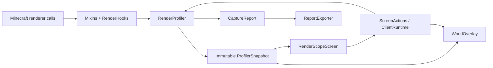

# Архитектура RenderScope 0.1.0

Релиз рассчитан на Minecraft **1.20.1** и имеет две отдельные цели сборки: **Forge 47.4.10** и исходную **NeoForge 47.1.106**. Выбор по умолчанию — `forge`; `-Ploader=neoforge` сохраняет исходный вариант. Упоминания API 1.21.1 в первоначальном задании не меняют целевую версию: точки вызовов, сигнатуры GUI и события проверяются для 1.20.1.

| Выбор | Зависимость Minecraft/loader | Каталог сборки | Дистрибутив |
| --- | --- | --- | --- |
| `forge` | `net.minecraftforge:forge:1.20.1-47.4.10` | `build/forge/` | `distribution/forge/renderscope-forge-0.1.0+mc1.20.1.jar` |
| `neoforge` | `net.neoforged:forge:1.20.1-47.1.106` | `build/neoforge/` | `distribution/renderscope-neoforge-0.1.0+mc1.20.1.jar` |

Forge 47.4.10 выбран из категории **Recommended** на [официальной странице Forge для 1.20.1](https://files.minecraftforge.net/net/minecraftforge/forge/index_1.20.1.html), проверенной 20 октября 2026 года. NeoForge остаётся на [исходном артефакте 47.1.106](https://maven.neoforged.net/releases/net/neoforged/forge/1.20.1-47.1.106/). Раздельные build/output каталоги изолируют классы, refmap, ресурсы, тестовые результаты и reobfuscation двух загрузчиков.

Пакеты `net.minecraftforge` и ID зависимости `forge` корректны для обеих этих веток 1.20.1. Общий адаптер Minecraft использует их существующие совместимые точки API; код профилировщика и UI не дублируется. Справочные материалы: [официальная документация Forge 1.20.1](https://docs.minecraftforge.net/en/1.20.1/) и [Screens / GuiGraphics 1.20.1](https://docs.minecraftforge.net/en/1.20.1/gui/screens/). Итоговые сигнатуры сверяются с фактически разрешёнными артефактами каждой цели.

## Разделение слоёв

| Слой | Ответственность |
| --- | --- |
| `dev.renderscope.core` | Измерения, окна статистики, агрегация, timeline, capture, неизменяемые значения |
| `dev.renderscope.mixin` | Инструментирование точных Minecraft-вызовов, для которых обычного события недостаточно |
| `dev.renderscope.client.RenderHooks` | Преобразование игровых объектов в value records, границы кадра и renderer scope |
| `ClientRuntime` | Регистрация событий, key mapping, применение настроек и выполнение действий UI |
| `LoaderInfo` | Фактическое имя и версия загруженного Forge/NeoForge для логов, smoke-проверки и JSON |
| `ModOwnership` | Разрешение имени мода и отдельного владельца класса рендерера |
| `client.ui` | Native Minecraft Screen, таблицы, поиск, сортировка, подробности и управление |
| `client.world` | Подсветка, отслеживание, теплокарта и HUD инспектора |
| `client.report` | Экспорт по явному списку разрешённых полей |

В `core` нет импортов Minecraft, Forge или NeoForge. Будущий адаптер Fabric может создавать те же `SampleContext`, вызывать границы кадра/вызова и читать те же snapshots. Это граница переносимости, а не заявление о наличии готовой Fabric-сборки.

## Точные точки измерения

`EntityRenderDispatcherMixin` оборачивает `EntityRenderer.render(...)` внутри мирового `EntityRenderDispatcher.render`. `BlockEntityRenderDispatcherMixin` оборачивает `BlockEntityRenderer.render(...)` внутри `BlockEntityRenderDispatcher.setupAndRender`.

Обе обёртки используют MixinExtras `WrapOperation`: исходный вызов выполняется с неизменёнными аргументами, завершение измерения находится в `finally`, исключение сохраняет обычное поведение Minecraft. Не подменяются renderer, `VertexConsumer` или `MultiBufferSource` стороннего мода. При вложенном инструментированном вызове `excludeNestedCall` исключает его сырой интервал из родительского wall/CPU time, сохраняя exclusive-атрибуцию без двойного учёта потомков.

`MinecraftMixin` отмечает начало и возврат `Minecraft.runTick`. `RenderLevelStageEvent` ограничивает сбор отдельных рендереров мировым проходом; инвентарные и другие сторонние отрисовки через тот же dispatcher за пределами этого прохода не становятся мировыми экземплярами.

В Full mode `BufferBuilderMixin` наблюдает завершение `endVertex` и размер текущего vertex format; `BufferSourceMixin` наблюдает `BufferSource.getBuffer(RenderType)`. Эти счётчики привязаны к активному scope. Timing Only отключает сбор геометрии, сохраняя измерения времени.

### Необязательная интеграция Mekanism

`MekanismDeferredRenderMixin` использует `@Pseudo` и строковый target `mekanism.client.render.RenderTickHandler`; зависимость от Mekanism в production classpath не добавляется. Точки сверены с артефактом **Mekanism-1.20.1-10.4.16.80.jar**: регистрация `addTransparentRenderer(RenderType, LazyRender)` и реальный вызов `LazyRender.render(...)` в `lambda$renderWorld$1`. Изменённые версии этих внутренних методов требуют отдельной проверки.

При регистрации задача связывается с value-only `SampleContext` активного мирового BER. `DeferredContexts` хранит не более 4 096 weak identity keys за кадр, копирует только контекст и имена RenderType и очищается на границах кадра/сессии. Ключи сравниваются по identity, а не по пользовательскому `equals`. Если один callback используется разными экземплярами, связь признаётся неоднозначной и не получает придуманного владельца; потеря ассоциации отмечается через `droppedMeasurements`.

Во время последующего вызова открывается новый scope того же экземпляра и исходного класса рендерера. `finally` завершает реальное измерение и сохраняет исключение. Время подготовки BER и время отложенного callback — два неперекрывающихся измеренных вызова. Обычный механизм `excludeNestedCall` также применяется, если callback оказался вложенным. Запрошенный при постановке в очередь RenderType переносится в scope, поскольку сам consumer может быть получен до его открытия. Timing Only собирает время без геометрии. Чужие callbacks, поставленные вне измеренного мирового scope, не приписываются случайному объекту.

Диагностические счётчики `RenderHooks.queuedDeferredCalls()`, `renderedDeferredCalls()` и `measuredDeferredCalls()` содержат только накопительные числа за текущую мировую сессию. Они позволяют проверить, что настоящая очередь, callback и атрибуция были задействованы. В точном Mekanism-артефакте этот путь используют в том числе RenderEnergyCube и RenderIndustrialAlarm; обычные FluidTank/DynamicTank рендерят жидкость непосредственно и сами по себе не доказывают работу deferred hook.

### Граница Create / Flywheel

В **Create 6.0.8 / Flywheel 1.0.5** обычный KineticBlockEntityRenderer может сразу вернуть управление, когда доступен visualization backend. Работа visuals, instancing и batch submission выполняется вне этого BER-интервала. RenderScope не выдаёт такой короткий вызов за полную стоимость объекта и не распределяет пакетную/GPU-стоимость по экземплярам. Счётчики Full также не видят геометрию, прошедшую мимо BufferBuilder.

Create `BlockEntityRenderHelper` вызывает BER напрямую для виртуальных block entities contraption, минуя наш dispatcher hook. Их локальные позиции не являются координатами блоков основного мира. Эти дочерние экземпляры не получают отдельной атрибуции/подсветки; обычная внешняя contraption entity остаётся измеряемой, если проходит через EntityRenderDispatcher. Фильтр `entity.getLevel() == Minecraft.level` дополнительно защищает от записи virtual/inventory объектов как физических мировых блоков. Это осознанная граница текущей модели, требующая отдельного родительского instance/transform adapter для расширения.

Проверенные первичные точки: [Create KineticBlockEntityRenderer 6.0.8](https://github.com/Creators-of-Create/Create/blob/mc1.20.1-6.0.8/src/main/java/com/simibubi/create/content/kinetics/base/KineticBlockEntityRenderer.java), [Create BlockEntityRenderHelper 6.0.8](https://github.com/Creators-of-Create/Create/blob/mc1.20.1-6.0.8/src/main/java/com/simibubi/create/foundation/render/BlockEntityRenderHelper.java), [Mekanism RenderTickHandler 1.20.x](https://github.com/mekanism/Mekanism/blob/1.20.x/src/main/java/mekanism/client/render/RenderTickHandler.java). Mekanism selector дополнительно сверяется с bytecode точного release JAR.

## Данные и срок жизни

`SampleContext` содержит registry ID, два владельца, имя класса, ключ экземпляра, позицию и bounds. Ключ блок-сущности состоит из категории, dimension и позиции. Для entity используется локальный числовой ID; UUID не нужен. Долговременные записи ядра не держат `Entity`, `BlockEntity`, world, renderer или consumer.

Новый мир либо смена dimension вызывают `RenderProfiler.clear()` и `WorldOverlay.clear()`. Поколение сессии предотвращает добавление позднего результата старого вызова в новую сессию. Повторное завершение одного token игнорируется.

Методы ядра синхронизированы. Snapshot и все его коллекции неизменяемы. Снимок кэшируется на 250 мс; экран читает снимок при обновлении, а не получает изменяемое состояние для каждой строки. Сбор не зависит от наличия открытого экрана.

Память ограничена: максимум 4 096 экземпляров на кадр, 8 192 кадров и 262 144 записей экземпляров/групп в rolling history, 4 096 ключей в каждой capture-агрегации. Timeline хранит около 300 точек за 30 секунд. Длинный capture имеет ограниченный timeline с постепенным укрупнением интервалов. При достижении лимитов `droppedMeasurements` отражает потерю детализации.

## Атрибуция

Основная группировка Mods использует namespace registry ID. Через ModList namespace разрешается в отображаемое имя; Minecraft и неизвестный владелец имеют явные fallback-имена.

Владелец класса рендерера определяется отдельно по пакету класса и пакетам загруженных mod files. Для классов Minecraft используется `minecraft`. Если один mod file содержит несколько mod IDs, пакет связывается с первым ID файла: это доступная атрибуция реализации, а не доказательство авторства каждой инструкции.

Mixin, внедрённый в класс другого мода или Minecraft, не меняет Java-класс этого рендерера. RenderScope не может приписать время каждой mixin-инъекции её автору. Именно поэтому registry owner и renderer class owner не объединяются в одно якобы точное значение.

## Клиентский UI и оверлеи

Экран построен на `Screen`, `GuiGraphics`, стандартных `Button` и `EditBox`, с прокручиваемыми таблицами. Разметка пересчитывается в `init()` при изменении размера. Тяжёлый GUI framework не используется. `isPauseScreen()` возвращает `false`.

F8 регистрируется обычным `KeyMapping` через `RegisterKeyMappingsEvent`. Кнопка в меню паузы добавляется через `ScreenEvent.Init.Post`; существующий PauseScreen сохраняется.

Подсветка выполняется через `RenderLevelStageEvent.Stage.AFTER_PARTICLES`, где эта версия загрузчика передаёт нужный camera pose. Стадия `AFTER_LEVEL` в NeoForge 47.1.106 имеет другую матрицу и не используется для мировых bounding boxes. У оверлея собственный buffer source: он не сбрасывает общие буферы чужих рендереров. Состояние GL и pose stack восстанавливаются. Entity bounds разрешаются по текущему ID непосредственно перед отрисовкой; в записи остаются только значения. Теплокарта учитывает категорию, расстояние, порог стоимости и лимит объектов. Для подписей проецируются экранные границы: пересекающиеся подписи, выход за край и наложение на HUD пропускаются с приоритетом выбранного и дорогих объектов. Число подписей дополнительно ограничено 32; bounding boxes при этом сохраняются.

## Отчёты, зависимости, сборка

`ReportExporter` вручную выбирает поля JSON. Имя и версия загрузчика берутся из runtime `LoaderInfo`, поэтому Forge-capture содержит Forge и его действительную версию, а NeoForge-capture — NeoForge. Экспортёр не сериализует сырые ключи экземпляров и игровые объекты. Dimension и position добавляются только при явном opt-in; имя игрока, сервер, мир, чат, UUID и абсолютные пути не запрашиваются для отчёта. Файл записывается локально, автоматической отправки нет.

Gradle 8.8 и JDK 21 создают Java 17 bytecode для загрузчиков 1.20.1; требование Java 21 для запуска профиля сохраняется. MixinExtras включён в основной JAR через Jar-in-Jar; `-slim` не является самостоятельным дистрибутивом. В одном клиентском профиле используется только один RenderScope JAR, соответствующий его загрузчику.

`scripts/build.ps1 -Loader forge|neoforge` передаёт Gradle `-Ploader=<цель>`, выбирает JDK 21 и копирует готовый JAR в нужный дистрибутив. Необязательный `-Smoke` запускает настоящий тестовый клиент. Source set `smoke` не входит в release JAR. Рабочие профили `run-smoke-forge/` и `run-smoke-neoforge/` раздельны; каждый запуск сохраняет собственные отчёт, capture и gallery в каталоге своего дистрибутива. Наличие NeoForge-галереи не считается доказательством проверки Forge.

`scripts/verify-release.py --loader forge|neoforge` проверяет соответствующие JAR, `build/<loader>/test-results/test` и настоящий loader/version в JSON capture. `scripts/package-release.py --loader forge|neoforge` упаковывает соответствующие артефакты и фактические медиа. Утилиты по умолчанию выбирают Forge. Forge-пакет: `distribution/forge/renderscope-forge-0.1.0-publication.zip`; исходный NeoForge-пакет сохраняется как `distribution/renderscope-0.1.0-publication.zip`.

Source set `compat` запускается командой `gradlew.bat -Ploader=forge runCompatClient`; отдельная `compatJar` создаёт reobfuscated `renderscope-forge-0.1.0+mc1.20.1-compat-harness.jar`. Он создаёт настоящие серверные fixtures Create 6.0.8 и Mekanism 10.4.16.80, проверяет обычные вызовы, charged-energy-cube deferred scope, Timing Only и Full, выбор/подсветку, capture и export privacy. Отдельная фаза временно выключает Flywheel backend и проверяет обычную кинетическую геометрию, затем восстанавливает исходный backend. Работа активного Flywheel проверяется как частичная наблюдаемость, без утверждения об измерении его GPU/instanced geometry.

Development-сценарий [завершился успешно](../distribution/forge/compatibility/compat-result.json). Активный backend был `flywheel:indirect`; queued/rendered/measured deferred-счётчики совпали: 673 в Full и 506 в Timing Only. Вал вращался с реальными 32 rpm, а fallback показал 216 наблюдаемых кинетических вершин за кадр. Для выбранных экземпляров обоих модов подтверждены отдельные box и label. Capture охватил 594 кадра за 5,0049888 секунды, экспорт проверен по версиям/приватности; сохранено семь игровых кадров. Это доказательство выбранной сцены, а не общей матрицы любых shader/renderer модов. Текущие unit/privacy XML содержат 22 успешных теста.

`scripts/test-installed-client.py` готовит изолированный Windows-профиль из официальных Forge installer/Mojang manifests и принимает production JAR плюс отдельный `--harness`. Только явный `--launch` открывает настоящий клиент; mapped/development classpath не используется. Раздельные каталоги `compatibility/` и `compatibility-installed/` не позволяют назвать запуск ForgeGradle установленной production-проверкой. Успех подтверждается свежим `compat-result.json`, версиями загрузчика/модов, environment и реальными счётчиками; один exit code не считается доказательством.

Installed-проверка [завершилась успешно](../distribution/forge/compatibility-installed/compat-result.json): `environment: installed-production`, Forge 47.4.10, production `jar`, default `flywheel:indirect` и отдельный `flywheel:off`. Реальные deferred-счётчики совпали: 649 в Full и 504 в Timing Only. Подтверждены отдельные boxes/labels двух модов, пять heatmap boxes и capture 594 кадров за 5,0036182 секунды. [Installed verification](../distribution/forge/compatibility-installed/installed-verification.json) подтверждает запуск и SHA-256 основного JAR `42b8b37b3e5f79a2695ab6c448cca47b587c65abf54d8345f26e0b1caf61a309`; семь скриншотов сохранены отдельно от development-сцены. Новый baseline Forge без Mekanism также прошёл smoke run с текущими 22 unit/privacy-тестами.

GPU queries, VRAM/texture-memory accounting, профилирование terrain, particles, item/GUI renderers и отдельные shader phases не включены в этот релиз. Ядро и типизированный `ObjectKind` оставляют отдельную точку для расширения категорий.
